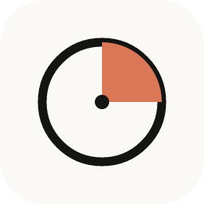
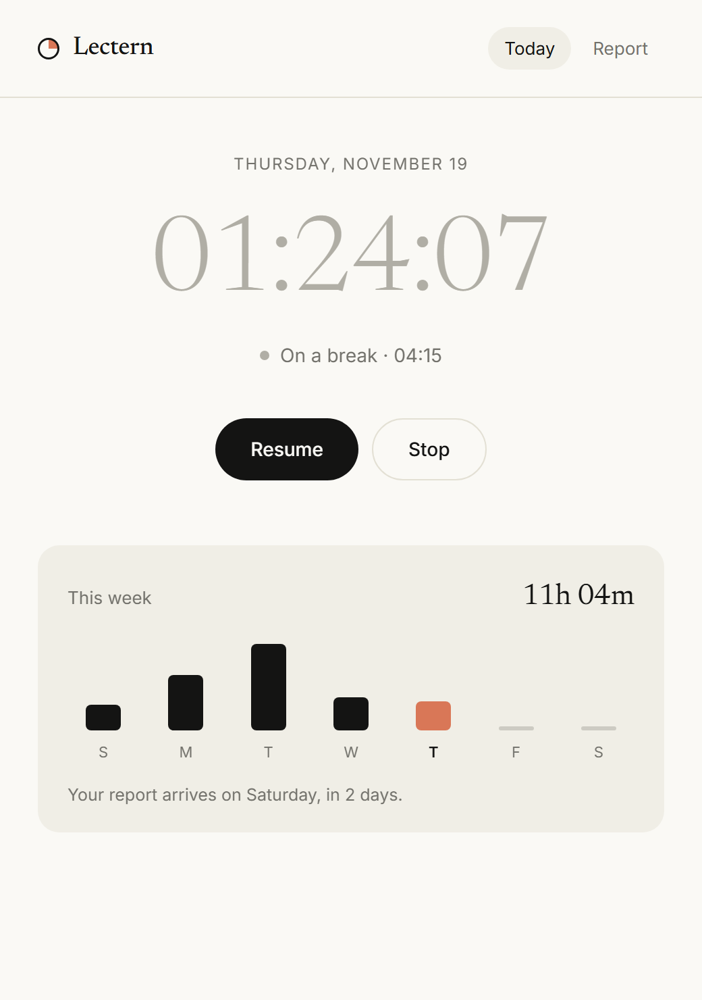

<p align="center">
  
</p>

<h1 align="center">Lectern</h1>

<p align="center">
  A quiet study timer that writes you a weekly report every Saturday.
</p>

<p align="center">
  <a href="https://github.com/mthsluna/lectern/releases/latest">Download for Windows</a>
  &nbsp;&middot;&nbsp;
  <a href="#how-it-works">How it works</a>
  &nbsp;&middot;&nbsp;
  <a href="#building-from-source">Build from source</a>
</p>

<br>

<p align="center">
  
  &nbsp;
  
  &nbsp;
  
</p>

<br>

## About

Lectern does one thing. You press start when you sit down to study, and it keeps
the time. At the end of the week it tells you, plainly, how the week went.

There is nothing to configure. Lectern reads the date from your computer, so it
always knows what day it is, which week you are in, and when Saturday has arrived.

## How it works

| Action | Meaning |
| :-- | :-- |
| **Start** | You are studying. The clock runs. |
| **Pause** | You are taking a break. Break time is tracked separately and never counts as study. |
| **Resume** | Back to work. |
| **Stop** | You are done for the day. The session is closed and saved. Stopping asks for a second click, so it never happens by accident. |

**The weekly report.** Weeks run from Sunday to Saturday. The first time you open
Lectern on a Saturday, the report opens by itself. If you skip Saturday, it is
waiting for you the next time you open the app. Every past week stays available
from the Report tab.

Each report includes:

- Total hours studied, compared with the week before
- A day-by-day chart, with your best day highlighted
- Days studied, daily average and best day
- Focus: the share of your sitting time spent studying rather than on breaks
- Number of breaks and sessions
- A short written summary of the week

**Nothing is lost.** Time is recorded as timestamps, not as a counter in memory.
If you close the window while the clock is running, it keeps counting, and you
will find the correct time when you return. A break left open past midnight ends
that day at the moment the break began.

## Lightweight by design

Lectern is built with [Tauri](https://tauri.app) and plain HTML, CSS and
JavaScript. There is no framework and no bundler. It uses the WebView already
built into Windows instead of shipping a browser, so the app is a few megabytes
and starts instantly.

Your data is a single JSON file on your own machine:

```
%APPDATA%\app.lectern.studytimer\lectern.json
```

No accounts, no network, no telemetry.

## Building from source

Requirements: [Rust](https://rustup.rs) and [Node.js](https://nodejs.org).

```bash
git clone https://github.com/mthsluna/lectern.git
cd lectern
npm install
npm run dev      # run in development
npm run build    # produce the installer in src-tauri/target/release/bundle
```

The interface lives in `src/` and can also be opened in any browser. In that case
data is kept in `localStorage`. Add `?demo` to the URL to preview it with sample data.

## Design

The palette is warm ivory and near-black ink with a single clay accent. Headings
and numbers are set in [Newsreader](https://fonts.google.com/specimen/Newsreader),
body text in [Inter](https://rsms.me/inter/). Both fonts are bundled, so the app
looks the same offline.

## License

[MIT](LICENSE)
