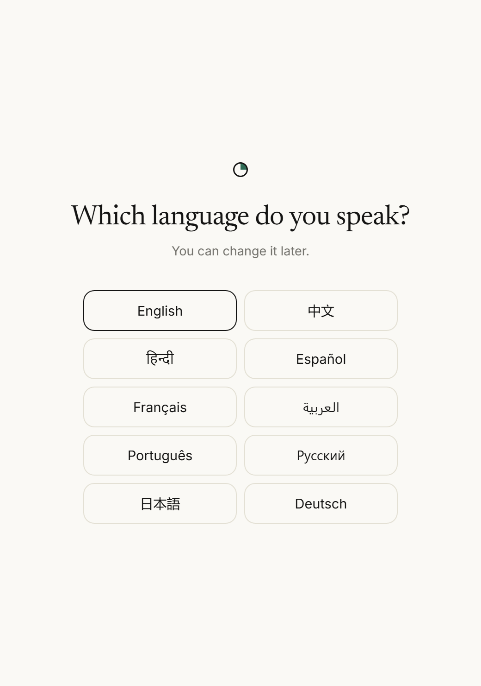
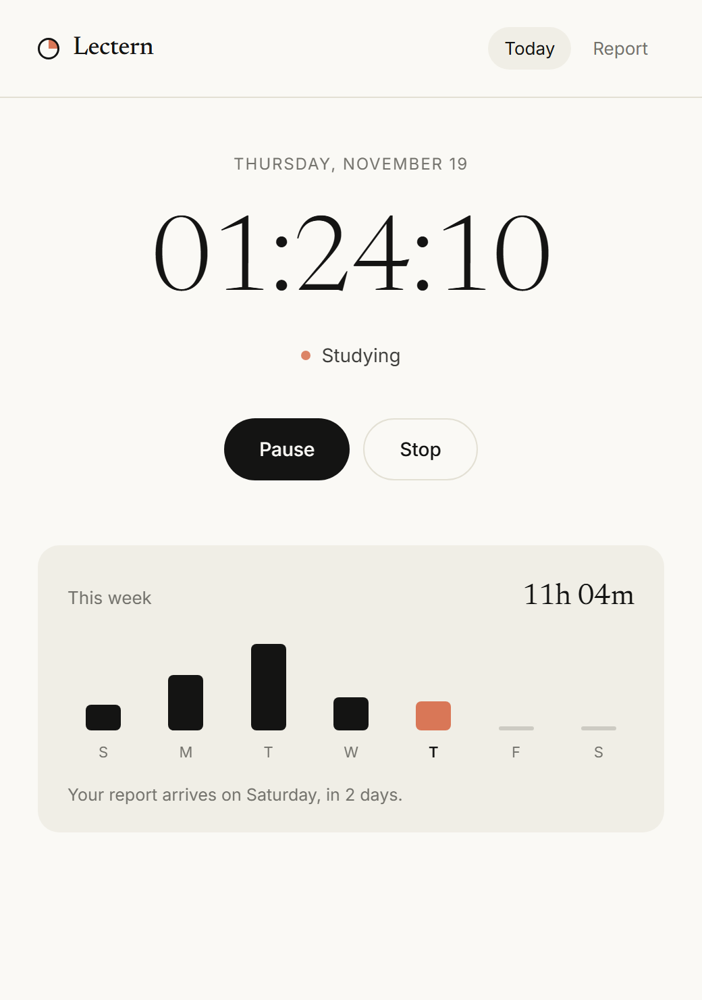
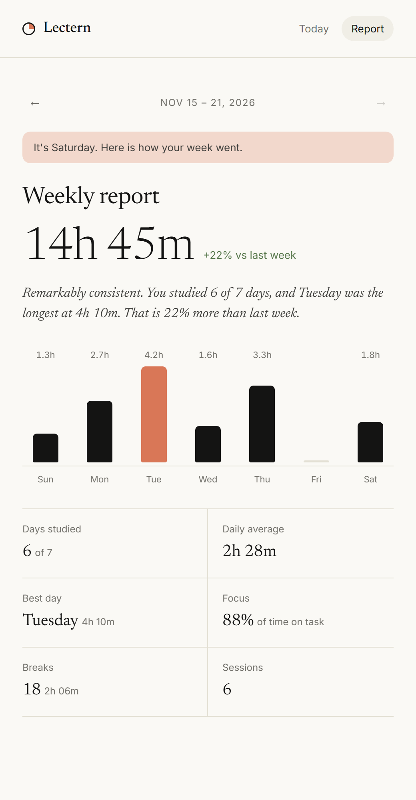

<p align="center">
  
  
</p>

<h1 align="center">Lectern</h1>

<p align="center">
  A quiet study timer that writes you a weekly report every Saturday.
</p>

<p align="center">
  <a href="https://github.com/mthsluna/lectern/releases/latest">Download for Windows</a>
  &nbsp;&middot;&nbsp;
  <a href="#how-it-works">How it works</a>
  &nbsp;&middot;&nbsp;
  <a href="#building-from-source">Build from source</a>
</p>

<br>

<p align="center">
  
  
  
  
</p>

<br>

## About

Lectern does one thing. You press start when you sit down to study, and it keeps
the time. At the end of the week it tells you, plainly, how the week went.

There is almost nothing to configure. On first launch Lectern asks which language
you speak, and that is all. It reads the date from your computer, so it always
knows what day it is, which week you are in, and when Saturday has arrived.

## How it works

| Action | Meaning |
| :-- | :-- |
| **Start** | You are studying. The clock runs. |
| **Pause** | You are taking a break. Break time is tracked separately and never counts as study. |
| **Resume** | Back to work. |
| **Stop** | You are done for the day. The session is closed and saved. Stopping asks for a second click, so it never happens by accident. |

**The weekly report.** Weeks run from Sunday to Saturday. The first time you open
Lectern on a Saturday, the report opens by itself. If you skip Saturday, it is
waiting for you the next time you open the app. Every past week stays available
from the Report tab.

Each report includes:

- Total hours studied, compared with the week before
- A day-by-day chart, with your best day highlighted
- Days studied, daily average and best day
- Focus: the share of your sitting time spent studying rather than on breaks
- Number of breaks and sessions
- A short written summary of the week

**Nothing is lost.** Time is recorded as timestamps, not as a counter in memory.
If you close the window while the clock is running, it keeps counting, and you
will find the correct time when you return. A break left open past midnight ends
that day at the moment the break began.

## Languages

Lectern speaks the ten most widely spoken languages:

English, 中文, हिन्दी, Español, Français, العربية, Português, Русский, 日本語 and Deutsch.

The question on the first screen is already asked in your system language when
Lectern knows it. Dates and weekday names follow the conventions of the language
you choose, and Arabic is laid out right to left. You can switch at any time from
the two-letter code in the top corner.

## Out of the way

Closing the window does not quit Lectern. The window is unloaded from memory
entirely and Lectern stays in the system tray as a single small process, about
27 MB, down from roughly 370 MB with the window open. Click the tray icon, or
open Lectern from the Start menu, to bring it back. To quit for real, right-click
the tray icon and choose Quit.

Your timer does not care either way. It keeps counting while the window is
closed, and even after quitting.

## Lightweight by design

Lectern is built with [Tauri](https://tauri.app) and plain HTML, CSS and
JavaScript. There is no framework and no bundler. It uses the WebView already
built into Windows instead of shipping a browser, so the app is a few megabytes
and starts instantly.

Your data is a single JSON file on your own machine:

```
%APPDATA%\app.lectern.studytimer\lectern.json
```

No accounts, no network, no telemetry.

## Building from source

Requirements: [Rust](https://rustup.rs) and [Node.js](https://nodejs.org).

```bash
git clone https://github.com/mthsluna/lectern.git
cd lectern
npm install
npm run dev      # run in development
npm run build    # produce the installer in src-tauri/target/release/bundle
```

The interface lives in `src/` and can also be opened in any browser. In that case
data is kept in `localStorage`. Add `?demo` to the URL to preview it with sample data, and `&lang=pt` (or any
other code) to preview a language.

## Design

The palette is warm ivory and near-black ink with a single deep jade accent.

Type follows the conventions of Apple's system interfaces: tight tracking on large
sizes, semibold headings, an ultralight timer and bold figures in the report. It is
set in [Inter](https://rsms.me/inter/), bundled so the app looks the same offline,
and switches to SF Pro automatically on Apple devices. Scripts Inter does not cover,
such as Chinese, Japanese, Devanagari and Arabic, use the system fonts that ship
with Windows.

## The mark

A four-pointed star rising from a horizon, set in a bookplate shield. The guiding
star is the one scholars and navigators followed: insight arriving, and a sense of
direction. The vector files live in [`docs/brand`](docs/brand), in ink for light
backgrounds and ivory for dark ones.

## License

[MIT](LICENSE)
