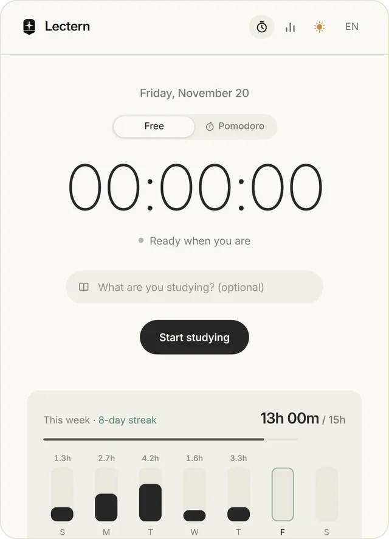
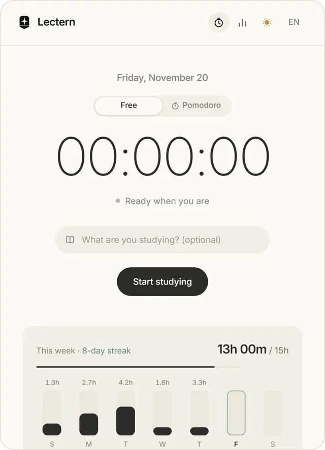
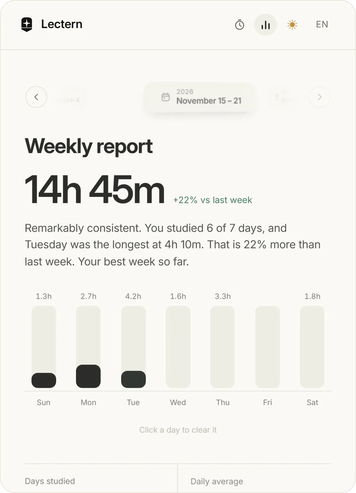

<div align="center">


# Lectern

**A quiet study timer for Windows that writes you a report of your week every Saturday.**

[**Download**](https://github.com/mthsluna/lectern/releases/latest) &nbsp;·&nbsp;
[Website](https://mthsluna.github.io/lectern/) &nbsp;·&nbsp;
[Changelog](CHANGELOG.md) &nbsp;·&nbsp;
[Report an issue](https://github.com/mthsluna/lectern/issues)

<br>


</div>

<br>

## Overview

Most study apps ask you to plan, tag and log before you can begin. Lectern asks for
one click. Press start when you sit down and pause when you stand up. Lectern keeps
the time, separates real focus from breaks, and every Saturday it opens a written
report of how your week actually went.

It is small (about 5 MB), installs without administrator rights, runs from the
system tray, works offline, and keeps your history in a single file on your own
computer.

## Contents

- [Features](#features)
- [See it in motion](#see-it-in-motion)
- [Installation](#installation)
- [Usage](#usage)
- [Privacy and data](#privacy-and-data)
- [FAQ](#faq)
- [Development](#development)
- [Credits and license](#credits-and-license)

## Features

| Feature | Description |
| :-- | :-- |
| **One-click timer** | Start, pause and stop. Breaks are tracked but never counted as study, and stopping asks twice so it never happens by accident. |
| **Weekly report** | Opens by itself on Saturday: total hours, change from last week, a day-by-day chart, focus ratio, time per subject and a short written summary. |
| **Pomodoro mode** | Classic 25 / 5 / 15 out of the box. Every length is adjustable, with a chime of your choice to start and end each break. |
| **Calendar** | Jump to any past week. Studied days, today and the open week each have their own marker. |
| **Goal and streak** | Set weekly hours once and watch them fill. A streak starts after two days in a row. |
| **Subjects** | Optionally name what you are studying. Lectern suggests past subjects with the hours already spent on each. |
| **Corrections** | Started the timer by mistake? Clear that day from the report, with a few seconds to undo. |
| **Accurate by design** | Time is stored as timestamps, not a counter. Sessions that cross midnight are split between the two days. |
| **Out of the way** | Closing the window sends Lectern to the system tray, where it uses about 27 MB. |
| **Ten languages** | English, 中文, हिन्दी, Español, Français, العربية, Português, Русский, 日本語 and Deutsch, in light or dark. |
| **In-place updates** | A single line announces a new version. One click downloads, verifies and swaps it in. |

## See it in motion

<table>
  <tr>
    <td align="center" width="33%"></td>
    <td align="center" width="33%"></td>
    <td align="center" width="33%"></td>
  </tr>
  <tr>
    <td align="center"><sub><b>Start studying</b><br>One click and the clock runs.</sub></td>
    <td align="center"><sub><b>Pomodoro</b><br>Lengths, chimes and volume.</sub></td>
    <td align="center"><sub><b>Weekly report</b><br>Charts, weeks and the calendar.</sub></td>
  </tr>
</table>

## Installation

1. Download **`Lectern-Setup-<version>.exe`** from the [latest release](https://github.com/mthsluna/lectern/releases/latest).
2. Run it, and choose whether you want a desktop shortcut and whether Lectern opens when Windows starts.
3. That is all. No administrator prompt and no account.

**Requirements:** Windows 10 or 11 (64-bit) with the Microsoft Edge WebView2 runtime,
which ships with Windows 11 and current versions of Windows 10.

<details>
<summary><b>Silent install and uninstall</b></summary>

<br>

| Command | Effect |
| :-- | :-- |
| `Lectern-Setup.exe --silent` | Installs or updates without a window, keeping your current choices. |
| `uninstall.exe --uninstall --silent` | Removes Lectern and keeps your study history. |

Lectern installs per user to `%LOCALAPPDATA%\Lectern`. To remove it normally, use
**Settings → Apps**; you will be asked whether to keep your history.

</details>

## Usage

### The timer

| Action | What it means |
| :-- | :-- |
| **Start** | You are studying. The clock runs. |
| **Pause** | You are on a break. It is tracked, never counted as study. |
| **Stop** | You are done for the day. Press twice to confirm. |

Type a subject before you start if you like, or leave it blank.

### Pomodoro

Switch the timer from **Free** to **Pomodoro** and it counts down instead. Click
**Pomodoro** again to open its settings.

| Setting | Default | Range |
| :-- | :-- | :-- |
| Focus | 25 min | 5 to 120 min |
| Short break | 5 min | 1 to 30 min |
| Long break | 15 min | 5 to 60 min |
| Long break after | 4 rounds | 2 to 8 rounds |

Choose a chime for *time to rest* and another for *time to study* from eight sounds,
or none, and set the volume to the exact percent. Focus counts as study and breaks as
break time, so the weekly report reads the same in either mode.

### The weekly report

The first time you open Lectern on a Saturday, the report appears on its own. If you
miss Saturday, it waits for your next visit. Use the arrows or the calendar to browse
earlier weeks, and click a day in the chart to clear it.

### Keyboard shortcuts

| Key | Action |
| :-- | :-- |
| <kbd>Space</kbd> | Start, pause or resume; skip a Pomodoro break |
| <kbd>S</kbd> | Stop (press twice) |
| <kbd>←</kbd> <kbd>→</kbd> | Previous or next week in the report |
| <kbd>Esc</kbd> | Close the calendar or the Pomodoro settings |

## Privacy and data

- **No account, no telemetry.** Nothing about you or your studying leaves your computer.
- **One local file.** Your history lives in `%APPDATA%\app.lectern.studytimer\lectern.json`.
  Copy it to back up or move to another computer.
- **Network use.** The only request Lectern makes is to GitHub, to check for a newer
  release. Offline, it simply skips the check.

## FAQ

<details>
<summary><b>What happens when I close the window?</b></summary>
<br>
Lectern keeps running in the system tray, near the clock. Click the icon to bring it
back, or right-click it and choose <b>Quit</b>. The timer, and Pomodoro chimes, keep
running either way.
</details>

<details>
<summary><b>What if I study past midnight?</b></summary>
<br>
Each day gets its own share. Studying from 22:00 to 03:00 counts 2 hours on the first
day and 3 on the next, and so do breaks and subjects. A break left open overnight ends
the session when the break began; sleep is not a break.
</details>

<details>
<summary><b>When does a week start?</b></summary>
<br>
On Sunday. The Saturday report covers Sunday through Saturday.
</details>

<details>
<summary><b>How do updates work?</b></summary>
<br>
When Lectern opens, it asks GitHub whether a newer release exists. If so, a line at
the top offers <b>Update</b>, <b>Not now</b> or <b>Skip this version</b>. Updating
downloads the new build, checks it against the SHA-256 digest published by GitHub,
replaces it and reopens Lectern. Your history is untouched.
</details>

<details>
<summary><b>Will reinstalling erase my history?</b></summary>
<br>
No. The uninstaller asks whether to keep it, and a reinstall picks up where you left off.
</details>

## Development

Lectern is built with [Tauri 2](https://tauri.app) (Rust) and plain HTML, CSS and
JavaScript, with no frontend framework.

**Prerequisites:** [Rust](https://rustup.rs) and [Node.js](https://nodejs.org) 20 or later.

```bash
git clone https://github.com/mthsluna/lectern.git
cd lectern
npm install
npm run dev
```

| Script | Description |
| :-- | :-- |
| `npm run dev` | Run the app with live reload. |
| `npm run build` | Build the installer and update package into `dist/`. |
| `npm run screenshots` | Regenerate the README showcase images. |
| `npm run screenshots:site` | Regenerate the website screenshots. |
| `npm run clips` | Record the animated clips by driving the real interface. |

<details>
<summary><b>Project structure</b></summary>

<br>

```text
lectern/
├── src/            App interface: HTML, CSS, JavaScript, translations, sounds
├── src-tauri/      Rust shell: window, tray, storage, update hand-off
├── setup/          The installer, a separate Tauri app in the same style
├── tools/          Build, screenshot and clip scripts
├── docs/           Website (GitHub Pages) and README images
└── CHANGELOG.md
```

</details>

Releases are published from the **Release build** workflow in GitHub Actions. Every
change is recorded in the [changelog](CHANGELOG.md).

## Credits and license

Released under the [MIT License](LICENSE).

Pomodoro chimes by [Qvantor](https://freesound.org/people/Qvantor/) on Freesound,
dedicated to the public domain under [CC0](https://creativecommons.org/publicdomain/zero/1.0/).
Interface typeface: [Inter](https://rsms.me/inter/), under the SIL Open Font License.

<br>

<div align="center">
<sub>Made by <a href="https://github.com/mthsluna">@mthsluna</a></sub>
</div>
